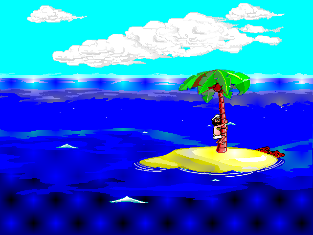
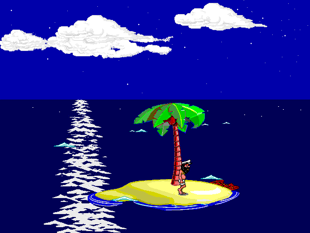
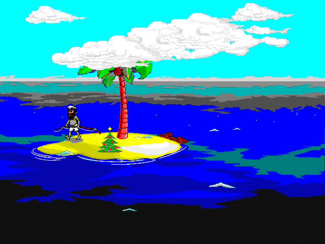

# Johnny32

A native 64-bit reimplementation of the 1992 Dynamix/Sierra screensaver
**Johnny Castaway** (internally *Screen Antics*, `SCRANTIC`). No DOSBox, no
NTVDM, no 16-bit code at run time.

| | | |
| :---: | :---: | :---: |
|  |  |  |
| Up the palm, mid-afternoon | Night, and the moon on the water | 25 December, and he has a tree |

Rendered by this port from a copy of the original data. The artwork is
Sierra's, and apart from these three screenshots none of it is redistributed
here: no archive, no executable, no exported sprites. The screensaver reads a
copy you supply.

## How it was built

The engine was read out of a disassembly of the original 16-bit executable
rather than reconstructed by watching the screensaver run. That covers the
resource archive and both of its codecs, the TTM animation interpreter, the
ADS scene sequencer, the scene scheduler and its eleven-day story, the walk
routes, the island placement, the surf, waves, clouds and glints, the holiday
calendar, the clock, and the sound effects. The write-ups are in `docs/`:

* [docs/ANALYSIS.md](docs/ANALYSIS.md): what is inside the download.
* [docs/FILE_FORMATS.md](docs/FILE_FORMATS.md): the archive, the codecs, the
  images, and the two bytecodes.
* [docs/SCHEDULER.md](docs/SCHEDULER.md): the scheduler, the walk, the
  island, the clock and the story.
* [docs/PRIOR_ART.md](docs/PRIOR_ART.md): the other reimplementations.

Most of the port is then checked against the binary itself rather than against
the reading. `tools/x86.py` is a small 16-bit interpreter that loads the
executable's segments and runs the original's own functions, and
`tools/oracle.py` puts the same questions to it and to the port and diffs the
answers. See "Checking it" below.

## Getting it running

The port has no dependencies: `cargo build` needs nothing but a Rust
toolchain. Python 3 is only for the tools, and nothing here needs a network.

You supply your own copy of the original. `johnnycastaway.exe` from
screensaverplanet.com is an NSIS installer wrapping a UPX-packed launcher
wrapping the untouched 1992 binary, and `tools/extract_original.py` unwraps
all three layers; it needs `7z` and `upx` on `PATH`. If you already have
`RESOURCE.001`, `RESOURCE.MAP` and `SCRANTIC.EXE`, drop them in `original/`
and skip that step.

### Linux

```sh
sudo apt install p7zip-full upx-ucl python3        # Debian/Ubuntu
curl --proto '=https' --tlsv1.2 -sSf https://sh.rustup.rs | sh

git clone https://github.com/f1zz1ec0ke/Johnny32 && cd Johnny32
python3 tools/extract_original.py                  # -> original/
cargo build --release --manifest-path johnny/Cargo.toml
./johnny/target/release/jcisland 600               # -> frames/*.png
```

### macOS

```sh
brew install p7zip upx python3
curl --proto '=https' --tlsv1.2 -sSf https://sh.rustup.rs | sh

git clone https://github.com/f1zz1ec0ke/Johnny32 && cd Johnny32
python3 tools/extract_original.py
cargo build --release --manifest-path johnny/Cargo.toml
./johnny/target/release/jcisland 600
```

On both, `jcisland` writes PNG frames rather than opening a window; the only
live display is the Windows shell. `ffmpeg -framerate 20 -i
frames/island_%04d.png johnny.mp4` turns a run into a video.

### Windows

This is the real thing, a screensaver Windows will run.

```sh
cargo build --release --bin johnny_scr
```

Rename `johnny_scr.exe` to `Johnny.scr`, right-click it and pick **Install**,
or drop it in `C:\Windows\System32`. Put `RESOURCE.001` and `RESOURCE.MAP`
beside it, or point `JC_DATA` at the folder holding them. Put `SCRANTIC.EXE`
there too and you get the sound effects, which live in its resource table
rather than in the archive; without it the island is silent and everything
else works.

Cross-compiling from Linux or macOS needs a mingw-w64 linker:

```sh
rustup target add x86_64-pc-windows-gnu
cargo build --release --target x86_64-pc-windows-gnu --bin johnny_scr
```

Type-checking the Windows-only code needs no linker at all:

```sh
rustup target add x86_64-pc-windows-msvc
cargo check --manifest-path johnny/Cargo.toml --target x86_64-pc-windows-msvc
```

`johnny_scr` takes the standard screensaver arguments: `/s` full screen,
`/p <HWND>` for the settings-dialog preview, `/c` for the config box. On more
than one monitor it covers the whole virtual desktop with one window but draws
one island per screen, each centred and in proportion. It has been run on a
three-monitor Windows desktop; development happens on a headless Linux
container.

## Settings

Settings live in `johnny.ini` beside the screensaver, under the same section
and key names the original used in `SCRANTIC.INI`, so a 1992 file works as it
is. `Speed` is the one key the original did not have.

```ini
[ScreenSaver.ScreenAntics]
StartTime=900        ; when Johnny's day begins, HHMM
Sounds=1
Clouds=1
Waves=1
Speed=100            ; percentage of the rate the data was authored at
Introduction=3       ; the story day on offer
NumDays=3            ; the story day reached
CurrentYear=1992     ; when those last moved on
```

The last four are not settings but state. The story is eleven days long and
advances only on real calendar days; `Introduction` and `NumDays` are the day
on offer and the day reached, and the screensaver writes them back when it
stops, as the original did, so the story carries on across sessions.

Johnny's day is eight real hours: the time of day is the number of half hours
since `StartTime`, counted modulo sixteen, and the last four phases are night.
The shipped dawn of nine in the morning puts dusk at three and the next dawn
at five.

`Speed` is a percentage of the original's pace. The engine has two clocks: a
16 ms software tick that counts every delay down, and a 55 ms Windows timer
that runs one pass of everything -- the surf, the walk, one step of the
running scene. A frame that asks for a delay of one tick is still on screen
for a whole pass, and the port keeps both clocks (`tools/oracle.py run` and
`tick` hold it to them). The machines of the day could not keep even that
pace, which is why the screensaver is remembered as slower still.

## The tools

```sh
python3 tools/extract_original.py     # the installer -> original/
python3 tools/verify.py               # every record, chunk, script and table
python3 tools/export_assets.py --sheets   # -> assets/: PNGs and script dumps
python3 tools/scheduler.py            # the scene table, story arc, holidays
python3 tools/scheduler.py --walk     # the route matrix and the 34 walk paths
python3 tools/ne_info.py original/scrantic.exe --disasm 6 --start 0xfc1
```

Running the engine:

```sh
cargo run --release --manifest-path johnny/Cargo.toml --bin jcisland -- 600
cargo run --release --manifest-path johnny/Cargo.toml --bin jcrender -- MJRAFT.TTM
cargo run --release --manifest-path johnny/Cargo.toml --bin jcplay -- MISCGAG.ADS 1
```

`jcisland` runs the whole screensaver and writes frames. Its switches, all
environment variables: `JC_NOWRITE=1` skips the PNGs, `JC_FROM`/`JC_TO`
bound which ticks are written, `JC_HHMM=1430` pins the clock (without it the
tool steps one phase per queue so a short run sees a whole day),
`JC_DATE=1992-12-25` pins the calendar, `JC_DAY=n` starts on a story day,
`JC_INTRO` sets how long the title card stays up in ticks, `JC_SPEED` and
`JC_DAWN` override the settings file, `JC_CHECK=1` turns on the repaint
check, and `JC_FAITHFUL=1` is described below. `jcrender` runs one TTM scene
and `jcplay` one ADS sequence.

## Where the port departs from the binary

Everything the port does is meant to be what the binary does, with these
exceptions. All of them are switched by `JC_FAITHFUL=1`, which restores the
original's behaviour.

* **The walk router.** One route block's weights sum to 150 while the
  original draws `rand() % 100`, so its last two options can never fire; they
  are the only ones that walk Johnny straight from area 1 to area 5. The port
  draws against the sum, as the engine's other two weighted pickers do.
* **The shells.** `seg3:0x02EA` draws a starfish and two shells on the beach.
  `ISLETEMP.SCR`, the engine's own render of the island, does not have them
  anywhere, and the composition matches it better without them.
* **The clouds.** The engine has a cloud walk that moves the clouds and
  refills the sky, but its per-pass backdrop function is called in a way that
  skips it, so in the original the clouds never move. The port runs the walk
  every pass, which is what the code was written to do.

Two things are not verified against the binary because they cannot be. The
sprite blit is GDI's, so there is no inner loop of Sierra's to compare; the
port writes its own. And the three ocean screens use palette index 0, the
transparency key, across large patches of open water; what the engine shows
there is not known, and the port shows the water they sit in.

## Checking it

`bash tools/check.sh` runs everything below, cheapest first. It needs the
original data in `original/`; the last steps also need `capstone`. The
default tier takes about half an hour; `JC_DEEP=1` runs the exhaustive case
lists and takes about three hours. `bash tools/deep.sh` runs that deep tier
one piece at a time into `deep/`, skipping the pieces already done, so a
machine that cannot stay up for three hours can get through it in sittings;
its last step merges the saved reach results and holds them to the floor.

**Unit tests** (`cargo test`) cover the arithmetic, the decoders and the
rules that were easy to read wrongly, and need no data.

**`tools/verify.py`** walks the archive and checks every record decodes,
every script disassembles end to end, the generated tables match the binary,
and a dozen facts about the data the port leans on.

**`tools/difftest.sh`** compares the Rust decoder with the Python one over
every chunk, frame and palette.

**`tools/sweep.py`** plays all 65 scenes the scheduler can pick with the
repaint check on; **`tools/coverage.py`** runs every story day, every holiday
and both halves of the clock; **`tools/framecheck.py`** looks at what the
scenes draw and complains about a blank frame or one that never moves.

The repaint check (`JC_CHECK=1`) holds the port's one structural departure
from the engine to an invariant. The engine re-runs every held frame every
tick; the port paints the backdrop afresh and puts back what each held frame
drew. That is the same picture only if putting a frame back draws exactly what
stepping it drew and changes nothing else, so the check paints every tick a
second time from the retained frames and compares the pixels, the loaded
artwork, the palette, the clip, the sound queue, the generator and each
instance's cursor.

**`jcisle`** scores the composed island against `ISLETEMP.SCR`, which is the
1992 engine's own render of it: the island at 96.5%, the palm trunk at 95.2%,
the fronds at 90.5%, and the whole composition at 92.3% over 18,248 painted
pixels. A piece one pixel out drops into single figures, so it is a sharp
check. This is the only place in the data where the original's pixels exist
to be compared.

**`tools/oracle.py`** is the main check. It runs the original's own functions
inside `tools/x86.py` and diffs the answers against `jcoracle`:

```
  rand        256 answers, all identical
  weighted    256 answers, all identical
  phase      2304 answers, all identical
  choose      256 answers, all identical
  choose2     256 answers, all identical
  choose4     256 answers, all identical
  queue        16 answers, all identical
  queue6       16 answers, all identical
  place      1536 answers, all identical
  adslen     2688 answers, all identical
  holiday     366 answers, all identical
  backdrop     64 answers, all identical
  repeat       12 answers, all identical
  island     8320 answers, all identical
  route      4736 answers, all identical
  turn        512 answers, all identical
  blocks     2688 answers, all identical
  seqpass    1662 answers, all identical
  seqrun     1056 answers, all identical
  codec       181 answers, all identical
  ttm        51475 answers, all identical
  tick       1072 answers, all identical
  water      1809 answers, all identical
  run        1500 answers, all identical
```

In order: the generator; the weighted chooser; the time-of-day arithmetic,
exhaustively; the scene chooser at three categories; the queue builder at two
times of day; where the island is dropped; the ADS instruction-length
function along every shipped script; the holiday calendar over a whole year;
the backdrop and island-placement bitmasks, exhaustively; how a scene's repeat
operand is stored; which way Johnny walks and which way he turns; where every
ADS block ends; one pass and then many passes of every ADS sequence inside the
engine's own interpreter; the original's LZW and RLE over every compressed
leaf; every frame of every TTM script through the original's frame runner;
whole passes of the engine, a scene at a time; the water and the sky --
every wave, glint and cloud in the engine's own arrays, pass by pass, for
nine kinds of backdrop; and the outer loop itself, `seg4:0x06BF`, driven
fifteen hundred passes with the scenes stood in for on both sides -- the
queue builder, the walk driver, the idles, the landings, the story and the
generator's whole state after every pass. `tools/listing.py` checks the
listing above against what the oracle printed, so it cannot go stale.

**`tools/reach.py`** measures how much of the scripts those queries actually
run, because agreement over an unreached instruction means nothing. Of the
2,688 words in the ten ADS scripts, 446 are structure the dispatcher is never
handed: headers, terminators, joiners, random-block separators, opcodes with
no handler, and the word after an `F010` that stops its own sequence. Each is
set aside with its reason read out of the binary, and a run that dispatches an
excused word fails. At the deep tier the queries reach all 2,242 of the rest,
all 6,631 TTM frames and all 611 scene markers, and every one of those cases
is a case the oracle diffs.

What the oracle found while it was being built is worth knowing, because each
one is a mistake a port made from the data alone would make: the `1420` and
`1430` joiners are AND and OR, not two spellings of one link; `1510` and
`1520` are different instructions; a `1350` guard means "has just ended", not
"is running"; the block skipper treats `1520` and the `10x0` guards as
ordinary words; bitmap slots belong to the loaded file, not the screen; the
clip and drawing colours belong to the instance; the draw order is the order
of the `1111` markers in the files, not play order; the script runs before the
instances each tick; a delay of zero is not a delay of one; and `A404` draws a
circle from its height alone.

## Artwork with more colours

Everything in `RESOURCE.001` is four-bit. The surface keeps an indexed buffer
the engine draws into and a colour buffer beside it, so an **art pack**, a
directory of PNGs named after what they replace, can stand in for any frame
or screen:

```text
art/
  JOHNWALK.BMP/000.png      art/OCEAN00.SCR.png
  JOHNWALK.BMP/001.png      art/ISLETEMP.SCR.png
```

`tools/export_assets.py` writes the originals out in exactly that shape.
Anything not replaced comes out of the archive. A replacement has to be the
size of the original, because the scripts place every sprite by hand, and
`jcart` reports the ones that are not. `tools/art_manifest.py` lists the
bitmaps by how often they are drawn.

## Layout

```
tools/extract_original.py   installer -> scrantic.exe + RESOURCE.001 + RESOURCE.MAP
tools/dgds.py               DGDS archive, chunks, LZW/RLE, images, PNG writer
tools/export_assets.py      RESOURCE.001 -> PNGs and readable script dumps
tools/ne_info.py            16-bit NE header dump, relocations and disassembler
tools/x86.py                a 16-bit x86 interpreter that runs the original's
                            own functions
tools/scheduler.py          the scene/story tables from the executable
tools/gen_tables.py         those tables again, as the Rust the port compiles
tools/art_manifest.py       which bitmaps are worth redrawing first

tools/check.sh              everything below, cheapest first
tools/verify.py             the archive, the scripts, the generated tables
tools/dgds_digest.py        canonical digest, for differential testing
tools/difftest.sh           the Rust decoder against the Python reference
tools/oracle.py             twenty-two questions put to the 1992 binary and
                            to the port, and diffed
tools/listing.py            the oracle listing above against the oracle
tools/reach.py              how much of the scripts the oracle reached
tools/scenes.py             the 65 scenes, derived from the scene table
tools/sweep.py              play all of them with the repaint check on
tools/framecheck.py         look at what they actually draw
tools/coverage.py           every story day, every holiday, day and night
johnny/src/bin/jcisle.rs    the island against the engine's own render of it

johnny/                     the Rust port
johnny/src/bin/johnny_scr.rs   the Windows .scr shell
docs/                       what was found, and how the formats work
```

`original/` and `assets/` are generated and not committed; both are derived
from Sierra's copyrighted data.
